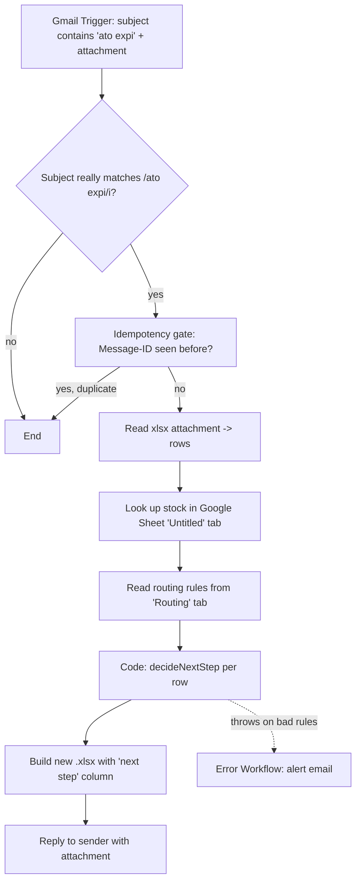

# ato-expiry-automation

A portfolio n8n workflow. **Everything in this repo is fake data** — the
"stock database" is a Google Sheet seeded with invented numbers, the
sample SKUs are made up, and nothing here talks to a real company system.

## Problem

An ATO ("about to obsolete" / expiry) report lands by email as an `.xlsx`
attachment listing finished-good SKUs that are running low or being
discontinued. For each SKU, someone needs to know what manufacturing step
to take next — and that depends on how far upstream the raw stock already
exists:

- Finished-good stock on hand? → nothing to do.
- Only a drilled blank exists? → just drill the rest.
- Only a raw panel exists? → edge and drill it.
- Nothing exists at any stage? → start from a cut panel.

This workflow reads the report, looks each SKU up against the "stock
database", applies that rule, and emails the sender back a new
spreadsheet with a `next step` column filled in.

## Flow



| Step | Node | Type |
|---|---|---|
| 1 | ATO Expiry Email | `gmailTrigger` |
| 2 | Subject really matches? | `if` |
| 3 | Already processed? (Message-ID) | `removeDuplicates` |
| 4 | Read xlsx attachment | `extractFromFile` |
| 5 | Look up stock | `googleSheets` (sticky note: *replace with a real SQL node*) |
| 6 | Read routing rules | `googleSheets` |
| 7 | Decide next step | `code` — the one pure-function node |
| 8 | Build xlsx | `convertToFile` |
| 9 | Reply with results | `gmail` |

A second workflow, `workflows/ato-expiry-error-handler.json`, is wired in
as the main workflow's **Error Workflow** and sends a failure alert email
instead of letting a failed run disappear silently.

## Routing table

Read live from the `Routing` tab of the stock sheet (seed it with this on
first setup — the workflow reads it every run, so edit it there to change
behaviour, not the workflow):

| stock prefix | stage | next step | check order |
|---|---|---|---|
| 300 | Finished good | Finished, no action | 1 |
| 310 | Drilled blank | Drill | 2 |
| 400 | Raw panel | Edge and drill | 3 |
| none | — | Cut, edge and drill | 4 |

Rules are checked in `check order`; the first prefix with `stock > 0`
wins. A SKU not present in the database at all gets `SKU NOT FOUND`
instead, and processing continues with the remaining rows.

The decision logic lives in one place: the `jsCode` of the "Decide next
step" node in `workflows/ato-expiry-automation.json`, as the pure
functions `decideNextStep()` and `buildStockIndex()`. Nothing about which
prefix maps to which step, or which order to check them in, is hardcoded
beyond the *shape* of a rule row (`prefix`, `nextStep`, `checkOrder`) —
that mapping and order both come from the sheet.

## Setup

1. **Import both workflows** into n8n: `workflows/ato-expiry-automation.json`
   and `workflows/ato-expiry-error-handler.json`.
2. **Credentials**: in each imported workflow, re-point the Gmail and
   Google Sheets nodes at your own credentials (n8n will prompt for this
   on import, since the exported JSON only contains credential
   *references*, never secrets). This repo assumes Gmail + Google Sheets
   OAuth2 apps; swap in IMAP/SMTP or Outlook nodes if you'd rather not use
   Gmail.
3. **Env vars**: copy `.env.example` to `.env` and fill in:
   - `STOCK_SHEET_ID` — the Google Sheet ID of your fake stock database.
   - `ALERT_EMAIL_TO` — where failure alerts should go.

   Your n8n instance must be started with
   `N8N_BLOCK_ENV_ACCESS_IN_NODE=false` for `{{ $env.X }}` expressions
   inside nodes to resolve at all (n8n blocks node-level env access by
   default since v1.x).
4. **Build the stock sheet**: create a Google Sheet with two tabs:
   - `Untitled` — headers `400 sku | 400 description | 400 qty | 310 sku
     | 310 description | 310 qty | fg sku | fg description | fg qty`
     (columns A–I, matching the task's A–I layout). The 400/310/300 SKUs
     for one product share the same 8 digits after their 3-digit prefix.
   - `Routing` — headers `stock prefix | stage | next step | check order`,
     seeded with the table above.
5. **Wire the Error Workflow**: in `ato-expiry-automation`'s workflow
   Settings, set *Error Workflow* to the imported
   `ato-expiry-error-handler` (this is set by workflow **ID**, which only
   exists once you've imported it — the placeholder
   `REPLACE_WITH_ERROR_HANDLER_WORKFLOW_ID` in the JSON is there so no
   fake/real ID ships in the export).
6. **Try it**: send yourself an email with a subject containing "ato
   expi" (any case) and `sample/input.xlsx` attached. Compare the reply
   against `sample/expected-output.xlsx`.

## Testing

```
npm test
```

Runs `tests/routing.test.js` under Node's built-in test runner (`node
--test`, no dependencies). The tests load `decideNextStep()` straight out
of `workflows/ato-expiry-automation.json` — they exercise exactly what
ships in the Code node, not a separate copy that could drift. Six cases:
the four routing outcomes, a SKU not found, and a malformed-rules input
that must throw rather than guess.

## Assumptions

- **Attachment binary property**: Gmail Trigger exposes a single
  attachment as `attachment_0`; the "Read xlsx attachment" node assumes
  exactly one attachment, matching the spec ("an .xlsx attachment").
- **Sheet header text**: the `Untitled` tab's headers and the `Routing`
  tab's headers are assumed to read exactly as shown in Setup step 4
  above (the task specifies column *meaning*, not literal header text).
- **Idempotency key**: the email's `Message-ID` header, via n8n's
  `removeDuplicates` node in "remove items seen in previous executions"
  mode — no external datastore needed.
- **Exact Google Sheets / Gmail node parameter names**: this repo targets
  the current (2026) n8n node shapes as closely as possible, but those
  node UIs have changed across n8n versions before; re-check field names
  against your installed version on first import.
- **One finished-good row per SKU** in the attachment; duplicate SKUs
  within one email are each looked up and routed independently, not
  merged.

## What I'd change for real systems

- **Replace the "Look up stock" node with a real SQL query node**
  (flagged in-canvas with a sticky note) against the actual stock
  database — likely parameterised by the batch of SKUs in one query
  rather than one Google Sheets read per run, with a proper index on the
  SKU column.
- **Auth**: service-account/least-privilege credentials scoped to just
  the stock tables and the shared mailbox, managed through n8n's
  credential store (or a secrets manager it reads from) rather than
  personal OAuth grants; rotate the Gmail/Sheets OAuth tokens on a
  schedule.
- **Logging/observability**: structured logs per execution (SKU count
  in, SKU count routed vs. not-found, execution id) shipped to wherever
  the rest of the stack logs to, plus a metric/alert on the *rate* of
  `SKU NOT FOUND` rather than just on hard failures — a sudden spike
  there usually means the upstream export changed shape before it means
  the SKUs are actually missing.
- **Validation**: schema-check the incoming attachment (header names,
  SKU format `^300\d{8}$`) before processing, and fail loudly on a
  malformed file instead of producing a spreadsheet full of nonsense.
- **Idempotency**: move the dedupe key from n8n's local store to the
  database itself (e.g. an `processed_messages` table keyed on
  Message-ID) so it survives an n8n data wipe and is auditable.
