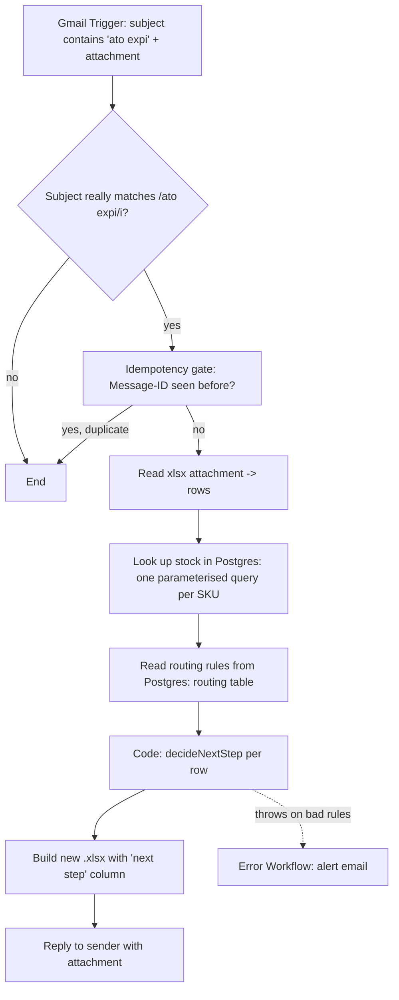

# ato-expiry-automation

A portfolio n8n workflow. **Everything in this repo is fake data** — the
"stock database" is a local-only Postgres container seeded from invented
numbers, the sample SKUs are made up, and nothing here talks to a real
company system.

## Problem

An ATO ("about to obsolete" / expiry) report lands by email as an `.xlsx`
attachment listing finished-good SKUs that are running low or being
discontinued. For each SKU, someone needs to know what manufacturing step
to take next — and that depends on how far upstream the raw stock already
exists:

- Finished-good stock on hand? → nothing to do.
- Only a drilled blank exists? → just drill the rest.
- Only a raw panel exists? → edge and drill it.
- Nothing exists at any stage? → start from a cut panel.

This workflow reads the report, looks each SKU up against the "stock
database", applies that rule, and emails the sender back a new
spreadsheet with a `next step` column filled in.

## Flow



| Step | Node | Type |
|---|---|---|
| 1 | ATO Expiry Email | `gmailTrigger` |
| 2 | Subject really matches? | `if` |
| 3 | Already processed? (Message-ID) | `removeDuplicates` |
| 4 | Read xlsx attachment | `extractFromFile` |
| 5 | Look up stock | `postgres` (sticky note: *swap the credential for the real stock DB*) |
| 6 | Read routing rules | `postgres` (`executeOnce`: the table is small and fixed) |
| 7 | Decide next step | `code` — the one pure-function node |
| 8 | Build xlsx | `convertToFile` |
| 9 | Reply with results | `gmail` |

A second workflow, `workflows/ato-expiry-error-handler.json`, is wired in
as the main workflow's **Error Workflow** and sends a failure alert email
instead of letting a failed run disappear silently.

## Routing table

Read live from Postgres's `routing` table every run (seeded from
`db/data/routing.csv` — edit that CSV and re-run `node db/make-seed.mjs`
to change behaviour, not the workflow):

| stock prefix | stage | next step | check order |
|---|---|---|---|
| 300 | Finished good | Finished, no action | 1 |
| 310 | Drilled blank | Drill | 2 |
| 400 | Raw panel | Edge and drill | 3 |
| none | — | Cut, edge and drill | 4 |

Rules are checked in `check order`; the first prefix with `stock > 0`
wins. A SKU not present in the database at all gets `SKU NOT FOUND`
instead, and processing continues with the remaining rows.

The decision logic lives in one place: the `jsCode` of the "Decide next
step" node in `workflows/ato-expiry-automation.json`, as the pure
functions `decideNextStep()` and `buildStockIndex()`. Nothing about which
prefix maps to which step, or which order to check them in, is hardcoded
beyond the *shape* of a rule row (`prefix`, `nextStep`, `checkOrder`) —
that mapping and order both come from the `routing` table.

## Setup

1. **Seed the database**: `node db/make-seed.mjs` reads
   `db/data/stock-sheet.csv` and `db/data/routing.csv` (zero dependencies,
   Node built-ins only) and writes `db/init/02-seed.sql`. Re-run it
   whenever those CSVs change.
2. **Start Postgres**: `cd db && docker compose up -d`. First start runs
   `db/init/01-schema.sql` then `02-seed.sql` automatically (Postgres only
   runs `docker-entrypoint-initdb.d` scripts on a *fresh* data volume — if
   you've started it before and need to reseed, `docker compose down -v`
   first).
3. **Import both workflows** into n8n: `workflows/ato-expiry-automation.json`
   and `workflows/ato-expiry-error-handler.json`.
4. **Credentials**: in each imported workflow, re-point the Gmail nodes at
   your own Gmail credential, and the two Postgres nodes at a new n8n
   Postgres credential named **"Stock DB (local)"**:
   - Host: `localhost` if n8n itself runs outside Docker; if n8n is
     *also* running in a Docker container, use `host.docker.internal`
     instead (`localhost` from inside a container means the container
     itself, not your machine).
   - Port: `5432`, Database: `stock`, User: `postgres`, Password: `dev`,
     SSL: disable (local test DB only — never do this against a real one).

   n8n will prompt for all of this on import, since the exported JSON
   only contains credential *references*, never secrets. This repo
   assumes a Gmail OAuth2 app; swap in IMAP/SMTP or Outlook nodes if
   you'd rather not use Gmail.
5. **Env vars**: copy `.env.example` to `.env` and fill in `ALERT_EMAIL_TO`
   (where failure alerts should go). Your n8n instance must be started
   with `N8N_BLOCK_ENV_ACCESS_IN_NODE=false` for `{{ $env.X }}`
   expressions inside nodes to resolve at all (n8n blocks node-level env
   access by default since v1.x).
6. **Wire the Error Workflow**: in `ato-expiry-automation`'s workflow
   Settings, set *Error Workflow* to the imported
   `ato-expiry-error-handler` (this is set by workflow **ID**, which only
   exists once you've imported it — the placeholder
   `REPLACE_WITH_ERROR_HANDLER_WORKFLOW_ID` in the JSON is there so no
   fake/real ID ships in the export).
7. **Try it**: send yourself an email with a subject containing "ato
   expi" (any case) and `sample/input.xlsx` attached. Compare the reply
   against `sample/expected-output.xlsx`.

## Database

Local-only Postgres 16 (`db/docker-compose.yml`), fake data, never meant
to leave your machine.

```sql
CREATE TABLE stock (
    sku         char(11) PRIMARY KEY,
    description text NOT NULL,
    qty         int NOT NULL DEFAULT 0
);

CREATE TABLE routing (
    prefix      text PRIMARY KEY,
    stage       text NOT NULL,
    next_step   text NOT NULL,
    check_order int NOT NULL
);
```

`stock` holds one row per SKU (not one row per product) — `db/make-seed.mjs`
reshapes the wide stock-sheet export (400/310/300 columns side by side,
one row per product) into this long format, so 500 sheet rows become
1,500 stock rows. `routing` holds the 4 rows from the Routing table
above. Both tables are populated once, at container creation, by
`db/init/02-seed.sql` (generated — don't hand-edit it, edit the CSVs and
regenerate).

The "Look up stock" node runs
`SELECT sku, qty FROM stock WHERE substr(sku, 4) = $1 ORDER BY sku;` once
per incoming row, parameterised on the 8 digits after the row's own
3-digit prefix — so it returns up to 3 rows (whichever of 300/310/400
exist for that product). The "Read routing rules" node runs
`SELECT prefix, stage, next_step, check_order FROM routing ORDER BY check_order;`
once total (`executeOnce: true`), since the table is small and the same
for every row.

## Testing

```
npm test
```

Runs `tests/routing.test.js` under Node's built-in test runner (`node
--test`, no dependencies). The tests load `decideNextStep()` and
`buildStockIndex()` straight out of `workflows/ato-expiry-automation.json`
— they exercise exactly what ships in the Code node, not a separate copy
that could drift. Eight cases: the four routing outcomes, a SKU not
found, a malformed-rules input that must throw, a sparse Postgres result
(a product missing one or more of its 300/310/400 rows), and routing
check-order coming from the rules table rather than being hardcoded.

**Live Postgres check — run 2026-10-12.** Against a fresh `stockdb`
container: `stock` has 1,500 rows, `routing` has 4, and the two Postgres
node queries (run verbatim from the workflow JSON) return results that,
fed through the Code node, give the same next step as
`sample/expected-output.xlsx` for all 11 rows of `sample/input.xlsx`.
`expected-output.xlsx` was worked out independently from
`db/data/stock-sheet.csv` (not by running the workflow's routing code).
Note the sample only exercises two paths: its 10 real SKUs have no stock
at any level, so all are "Cut, edge and drill", plus one deliberately
unknown SKU for "SKU NOT FOUND". The other three outcomes are covered by
the unit tests above, not by the sample file.

## Assumptions

- **Attachment binary property**: Gmail Trigger exposes a single
  attachment as `attachment_0`; the "Read xlsx attachment" node assumes
  exactly one attachment, matching the spec ("an .xlsx attachment").
- **Idempotency key**: the email's `Message-ID` header, via n8n's
  `removeDuplicates` node in "remove items seen in previous executions"
  mode — no external datastore needed.
- **Exact Postgres / Gmail node parameter names**: this repo targets the
  current (2026) n8n node shapes as closely as possible — in particular
  the Postgres node's per-item query-parameter field is assumed to be
  `options.queryReplacement`, an expression returning an array — but
  node UIs have changed across n8n versions before; re-check field names
  against your installed version on first import.
- **`host.docker.internal` resolves from inside a container** on Docker
  Desktop (Windows/Mac) and on recent Docker Engine on Linux; on older
  Linux Docker you may need `--add-host=host.docker.internal:host-gateway`
  or to point the credential at the host's LAN IP instead.
- **One finished-good row per SKU** in the attachment; duplicate SKUs
  within one email are each looked up and routed independently, not
  merged.

## What I'd change for real systems

- **Swap the Postgres credential for the real stock database connection**
  (flagged in-canvas with a sticky note), and batch the per-row lookup
  into one query (`WHERE substr(sku, 4) = ANY($1)`) instead of one
  round-trip per SKU — fine for a handful of rows per email, not fine at
  real warehouse-export volume.
- **Secrets**: `POSTGRES_PASSWORD: dev` in `db/docker-compose.yml` is
  fine for a local throwaway container and nowhere else — a real
  deployment reads the DB password from a secrets manager into the n8n
  credential, never commits it, and uses TLS instead of `sslmode=disable`.
  Same for Gmail: service-account/least-privilege credentials scoped to
  just the shared mailbox, with scheduled OAuth token rotation.
- **Schema management**: `docker-entrypoint-initdb.d` only runs once,
  against a fresh volume — fine for a disposable test DB, not a
  migration strategy. A real stock DB would use a proper migration tool
  (and wouldn't be reseeded from a CSV export at all).
- **Connection handling**: a long-running n8n instance hitting Postgres
  on every email wants connection pooling (e.g. PgBouncer) in front of
  it, not a fresh connection per node execution.
- **Logging/observability**: structured logs per execution (SKU count
  in, SKU count routed vs. not-found, execution id) shipped to wherever
  the rest of the stack logs to, plus a metric/alert on the *rate* of
  `SKU NOT FOUND` rather than just on hard failures — a sudden spike
  there usually means the upstream export changed shape before it means
  the SKUs are actually missing.
- **Validation**: schema-check the incoming attachment (header names,
  SKU format `^300\d{8}$`) before processing, and fail loudly on a
  malformed file instead of producing a spreadsheet full of nonsense.
- **Idempotency**: move the dedupe key from n8n's local store to the
  database itself (e.g. an `processed_messages` table keyed on
  Message-ID) so it survives an n8n data wipe and is auditable.
