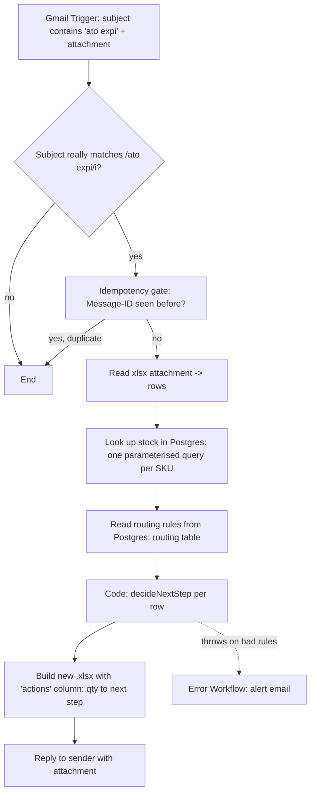

# ato-expiry-automation

A portfolio n8n workflow. **Everything in this repo is fake data** — the
"stock database" is a local-only Postgres container seeded from invented
numbers, the sample SKUs are made up, and nothing here talks to a real
company system.

## Problem

An ATO ("about to obsolete" / expiry) report lands by email as an `.xlsx`
attachment listing finished-good SKUs that are running low or being
discontinued. For each SKU, someone needs to know what manufacturing step
to take next — and that depends on how far upstream the raw stock already
exists:

- Enough finished-good stock to cover the qty asked for? → nothing to do;
  the row is left out of the reply.
- Only a drilled blank exists? → just drill the rest.
- Only a raw panel exists? → edge and drill it.
- Nothing exists at any stage? → start from a cut panel.

This workflow reads the report, looks each SKU up against the "stock
database", applies that rule, and emails the sender back a new
spreadsheet with columns `sku`, `description` and `actions`. The
`actions` cell holds the row's `qty` and its next step, e.g.
`20 to Edge and drill`, so there is no separate `qty` column. Rows
already covered by finished stock are dropped before it is sent.

## Flow



| Step | Node | Type |
|---|---|---|
| 1 | ATO Expiry Email | `gmailTrigger` |
| 2 | Subject really matches? | `if` |
| 3 | Already processed? (Message-ID) | `removeDuplicates` |
| 4 | Read xlsx attachment | `extractFromFile` |
| 5 | Look up stock | `postgres` (sticky note: *swap the credential for the real stock DB*) |
| 6 | Read routing rules | `postgres` (`executeOnce`: the table is small and fixed) |
| 7 | Decide next step | `code` — the routing logic, as pure functions |
| 8 | Build xlsx | `code` — writes the .xlsx: borders on every cell, columns sized to fit |
| 9 | Reply with results | `gmail` |

"Build xlsx" writes the workbook itself instead of using n8n's Convert
to File node, which can't set column widths or borders. The Code node
can't load an xlsx library without changing n8n's settings, so
`buildXlsx()` writes the few XML files an .xlsx contains and zips them
(uncompressed) with plain JavaScript. It is tested by
`tests/xlsx.test.js`, and `scripts/independent_check.py` checks the
layout of any result file (thin border on every cell, every column at
least as wide as its longest value).

The reply goes back on the original email's thread with
`ato-expiry-results.xlsx` attached. That reply has the same subject and
an attachment, so it would match the trigger too (when you email
yourself it also lands in your inbox). To stop the workflow processing
its own reply, and replying again every minute, the trigger query has
`-filename:ato-expiry-results.xlsx` and "Subject really matches?" also
requires the attachment not to be named `ato-expiry-results.xlsx`.
Gmail's search is fuzzy, so the IF check is the one to rely on.

A second workflow, `workflows/ato-expiry-error-handler.json`, is wired in
as the main workflow's **Error Workflow** and sends a failure alert email
instead of letting a failed run disappear silently.

## Routing table

Read live from Postgres's `routing` table every run (seeded from
`db/data/routing.csv` — edit that CSV and re-run `node db/make-seed.mjs`
to change behaviour, not the workflow):

| stock prefix | stage | next step | check order |
|---|---|---|---|
| 300 | Finished good | Finished, no action | 1 |
| 310 | Drilled blank | Drill | 2 |
| 400 | Raw panel | Edge and drill | 3 |
| none | — | Cut, edge and drill | 4 |

Rules are checked in `check order`; the first prefix with `stock > 0`
wins, except the finished (300) level: it only counts when its stock is
**at least the `qty` asked for in the email**. Such a row needs nothing
doing, so it is **dropped from the reply**. If the email asks for more
than the finished stock, the row stays and routes on the 310/400 stock as
usual. A SKU not present in the database at all gets `SKU NOT FOUND`
instead, and processing continues with the remaining rows.

Each output row's `actions` cell is `<qty> to <next step>`, with the
email's `qty` and the step text exactly as in the table:
`58 to Edge and drill`. `SKU NOT FOUND` rows show just that, with no qty
in front. A blank `qty` leaves just the step. If every row is dropped,
the Code node outputs no items, so
n8n stops there and **no reply is sent** for that email.

The decision logic lives in one place: the `jsCode` of the "Decide next
step" node in `workflows/ato-expiry-automation.json`, as the pure
functions `decideNextStep()`, `buildStockIndex()`, `formatAction()` and
`buildResultRows()`. Nothing about which
prefix maps to which step, or which order to check them in, is hardcoded
beyond the *shape* of a rule row (`prefix`, `nextStep`, `checkOrder`) —
that mapping and order both come from the `routing` table.

## Setup

1. **Seed the database**: `node db/make-seed.mjs` reads
   `db/data/stock-sheet.csv` and `db/data/routing.csv` (zero dependencies,
   Node built-ins only) and writes `db/init/02-seed.sql`. Re-run it
   whenever those CSVs change.
2. **Start Postgres**: `cd db && docker compose up -d`. First start runs
   `db/init/01-schema.sql` then `02-seed.sql` automatically (Postgres only
   runs `docker-entrypoint-initdb.d` scripts on a *fresh* data volume — if
   you've started it before and need to reseed, `docker compose down -v`
   first).
3. **Import both workflows** into n8n: `workflows/ato-expiry-automation.json`
   and `workflows/ato-expiry-error-handler.json`.
4. **Credentials**: in each imported workflow, re-point the Gmail nodes at
   your own Gmail credential, and the two Postgres nodes at a new n8n
   Postgres credential named **"Stock DB (local)"**:
   - Host: `localhost` if n8n itself runs outside Docker; if n8n is
     *also* running in a Docker container, use `host.docker.internal`
     instead (`localhost` from inside a container means the container
     itself, not your machine).
   - Port: `5432`, Database: `stock`, User: `postgres`, Password: `dev`,
     SSL: disable (local test DB only — never do this against a real one).

   n8n will prompt for all of this on import, since the exported JSON
   only contains credential *references*, never secrets. This repo
   assumes a Gmail OAuth2 app; swap in IMAP/SMTP or Outlook nodes if
   you'd rather not use Gmail.
5. **Env vars**: copy `.env.example` to `.env` and fill in `ALERT_EMAIL_TO`
   (where failure alerts should go). Your n8n instance must be started
   with `N8N_BLOCK_ENV_ACCESS_IN_NODE=false` for `{{ $env.X }}`
   expressions inside nodes to resolve at all (n8n blocks node-level env
   access by default since v1.x).
6. **Wire the Error Workflow**: in `ato-expiry-automation`'s workflow
   Settings, set *Error Workflow* to the imported
   `ato-expiry-error-handler` (this is set by workflow **ID**, which only
   exists once you've imported it — the placeholder
   `REPLACE_WITH_ERROR_HANDLER_WORKFLOW_ID` in the JSON is there so no
   fake/real ID ships in the export). The repo JSON deliberately keeps
   that placeholder: workflow IDs are per n8n instance, so any real ID
   would be wrong on everyone else's. The error handler's Gmail node also
   needs your Gmail credential before it can send anything.
7. **Try it**: send yourself an email with a subject containing "ato
   expi" (any case) and `sample/input.xlsx` attached, then either click
   **Execute workflow** (fetches the newest matching email) or activate
   the workflow (polls every minute). Compare the reply's attachment
   against `sample/expected-output.xlsx`. For a smaller run that hits
   every outcome, including dropped rows, use `sample/input-mixed.xlsx` /
   `sample/expected-output-mixed.xlsx` instead. To check a run without
   reading the reply, use the live test workflow under Testing.

## Database

Local-only Postgres 16 (`db/docker-compose.yml`), fake data, never meant
to leave your machine.

```sql
CREATE TABLE stock (
    sku         char(11) PRIMARY KEY,
    description text NOT NULL,
    qty         int NOT NULL DEFAULT 0
);

CREATE TABLE routing (
    prefix      text PRIMARY KEY,
    stage       text NOT NULL,
    next_step   text NOT NULL,
    check_order int NOT NULL
);
```

`stock` holds one row per SKU (not one row per product) — `db/make-seed.mjs`
reshapes the wide stock-sheet export (400/310/300 columns side by side,
one row per product) into this long format, so 500 sheet rows become
1,500 stock rows. `routing` holds the 4 rows from the Routing table
above. Both tables are populated once, at container creation, by
`db/init/02-seed.sql` (generated — don't hand-edit it, edit the CSVs and
regenerate).

The "Look up stock" node runs
`SELECT sku, qty FROM stock WHERE substr(sku, 4) = $1 ORDER BY sku;` once
per incoming row, parameterised on the 8 digits after the row's own
3-digit prefix — so it returns up to 3 rows (whichever of 300/310/400
exist for that product). The "Read routing rules" node runs
`SELECT prefix, stage, next_step, check_order FROM routing ORDER BY check_order;`
once total (`executeOnce: true`), since the table is small and the same
for every row.

## Testing

```
npm test
```

Runs `tests/routing.test.js` under Node's built-in test runner (`node
--test`, no dependencies). The tests load `decideNextStep()` and
`buildStockIndex()` straight out of `workflows/ato-expiry-automation.json`
— they exercise exactly what ships in the Code node, not a separate copy
that could drift. Eight cases: the four routing outcomes, a SKU not
found, a malformed-rules input that must throw, a sparse Postgres result
(a product missing one or more of its 300/310/400 rows), and routing
check-order coming from the rules table rather than being hardcoded. It
also covers the `actions` cell format, finished stock below / equal to /
above the qty asked for, and dropping covered rows from the result.

**Sample sets.** Both expected-output files are worked out independently
from `db/data/stock-sheet.csv` by `scripts/independent_check.py` (a
hand-written copy of the rule, *not* the workflow's routing code); run it
without `--write` to re-check a pair:

```
python scripts/independent_check.py sample/input.xlsx sample/expected-output.xlsx
```

| Set | Rows in → out | Dropped (finished covers qty) | Drill | Edge and drill | Cut, edge and drill | SKU NOT FOUND |
|---|---|---|---|---|---|---|
| `input.xlsx` — the 10 "tiled panels needed today" SKUs + 1 unknown | 11 → 11 | 0 | 3 | 3 | 4 | 1 |
| `input-mixed.xlsx` — every outcome, plus the finished-stock edges | 7 → 5 | 2 | 1 | 2 | 1 | 1 |

The mixed set is 30010482731 (the stock sheet's first product, 584
finished on hand against a made-up report qty of 25: dropped),
30040995108, 30026196225 and 30061891516 from the tiled set, the unknown
30099999999, 30094410887 (42 finished against a made-up qty of 100: kept,
routed on its 741 at 400 → `100 to Edge and drill`) and 30034643897
(33 finished against a made-up qty of 33: covered exactly, dropped).

**Live Postgres check — run 2026-10-17** (after the `actions` column and
the drop rule). The whole "Decide next step" code, glue included, run
against real results of the two Postgres queries, gives exactly the rows
of `expected-output.xlsx` (11/11) and `expected-output-mixed.xlsx` (5/5,
with the 2 covered rows dropped), in both workflow files. `npm test`:
14/14 pass.

**Live Postgres check — run 2026-10-16.** Against a fresh `stockdb`
container (`down -v` then `up -d`): `stock` has 1,500 rows, `routing` has
4. The two Postgres node queries, run verbatim from the workflow JSON
with the SKU body bound as `$1`, return results that, fed through the
Code node's `buildStockIndex()` / `decideNextStep()`, give the same next
step as the expected-output file for all 11 rows of `input.xlsx` and
all 5 rows of `input-mixed.xlsx`. `npm test`: 8/8 pass.

### Live test workflow

`workflows/ato-expiry-automation.test.json` is the production pipeline
with the email reply swapped for a file on disk, so a run can be checked
without reading the reply:

```
Gmail Trigger -> Subject really matches? -> Already processed? (Message-ID)
  -> Read xlsx attachment -> Look up stock -> Read routing rules
  -> Decide next step -> Build xlsx -> Write result file
```

Every node except the last is configured like production, apart from
production's own-reply guard (above): the trigger uses the query
`subject:"ato expi" has:attachment`, `simple: false`
and **Download Attachments** on, so the attachment arrives on the
`attachment_0` binary property that "Read xlsx attachment" reads. Build
xlsx puts the result on binary `data`, which production's Reply node
attaches and the test's "Write result file" writes to
`C:/Users/luket/.n8n-files/ato-expiry-automation/<attachment name>-result.xlsx`.
The attachment name comes from the email's sender, so it is reduced to
letters, digits, `_` and `-` (max 64 characters) before it is used in
the path; a name like `../x.xlsx` cannot leave the folder.

That folder is used because n8n 2.x only lets file nodes write inside
`~/.n8n-files` by default (`N8N_RESTRICT_FILE_ACCESS_TO`), and the write
node does not create folders, so it must exist first. On another
machine, change the path in "Write result file" to your own
`~/.n8n-files` folder written out in full (`~` is not expanded in a file
name).

To run the live test:

1. Import `workflows/ato-expiry-automation.test.json`, attach your Gmail
   credential to "Gmail Trigger" and "Stock DB (local)" to both Postgres
   nodes (Setup step 4), and create the output folder.
2. Email yourself with a subject containing **ato expi** (any case) and
   `sample/input.xlsx` as the only attachment.
3. Either click **Execute workflow** in the editor (the trigger fetches
   the newest matching email) or activate the workflow and wait for the
   next poll (every minute).
4. Check the result independently:

   ```
   python scripts/independent_check.py sample/input.xlsx "C:/Users/luket/.n8n-files/ato-expiry-automation/input-result.xlsx"
   ```

   It should print `ALL MATCH` against the same rows as
   `sample/expected-output.xlsx`. For every outcome, including 2 dropped
   rows (7 rows in, 5 out), attach `sample/input-mixed.xlsx` instead and
   check
   `input-mixed-result.xlsx` against `sample/input-mixed.xlsx`.

The Message-ID dedupe is live in the test too: each email is processed
once, so a second run on the same email outputs nothing. Send a fresh
email for every run.

**Earlier disk-input run — 2026-10-17** (n8n 2.27.4, `n8n execute`, before
the trigger was switched to Gmail): with the samples fed in from disk,
the same middle nodes produced output matching `expected-output.xlsx`
(11/11) and `expected-output-mixed.xlsx` (5/5) on every column.

## Assumptions

- **Attachment binary property**: Gmail Trigger exposes a single
  attachment as `attachment_0`; the "Read xlsx attachment" node assumes
  exactly one attachment, matching the spec ("an .xlsx attachment").
- **Idempotency key**: the email's `Message-ID` header, via n8n's
  `removeDuplicates` node in "remove items seen in previous executions"
  mode — no external datastore needed.
- **Exact Postgres / Gmail node parameter names**: this repo targets the
  current (2026) n8n node shapes as closely as possible — in particular
  the Postgres node's per-item query-parameter field is assumed to be
  `options.queryReplacement`, an expression returning an array — but
  node UIs have changed across n8n versions before; re-check field names
  against your installed version on first import.
- **`host.docker.internal` resolves from inside a container** on Docker
  Desktop (Windows/Mac) and on recent Docker Engine on Linux; on older
  Linux Docker you may need `--add-host=host.docker.internal:host-gateway`
  or to point the credential at the host's LAN IP instead.
- **One finished-good row per SKU** in the attachment; duplicate SKUs
  within one email are each looked up and routed independently, not
  merged.

## What I'd change for real systems

- **Swap the Postgres credential for the real stock database connection**
  (flagged in-canvas with a sticky note), and batch the per-row lookup
  into one query (`WHERE substr(sku, 4) = ANY($1)`) instead of one
  round-trip per SKU — fine for a handful of rows per email, not fine at
  real warehouse-export volume.
- **Secrets**: `POSTGRES_PASSWORD: dev` in `db/docker-compose.yml` is
  fine for a local throwaway container and nowhere else — a real
  deployment reads the DB password from a secrets manager into the n8n
  credential, never commits it, and uses TLS instead of `sslmode=disable`.
  Same for Gmail: service-account/least-privilege credentials scoped to
  just the shared mailbox, with scheduled OAuth token rotation.
- **Schema management**: `docker-entrypoint-initdb.d` only runs once,
  against a fresh volume — fine for a disposable test DB, not a
  migration strategy. A real stock DB would use a proper migration tool
  (and wouldn't be reseeded from a CSV export at all).
- **Connection handling**: a long-running n8n instance hitting Postgres
  on every email wants connection pooling (e.g. PgBouncer) in front of
  it, not a fresh connection per node execution.
- **Logging/observability**: structured logs per execution (SKU count
  in, SKU count routed vs. not-found, execution id) shipped to wherever
  the rest of the stack logs to, plus a metric/alert on the *rate* of
  `SKU NOT FOUND` rather than just on hard failures — a sudden spike
  there usually means the upstream export changed shape before it means
  the SKUs are actually missing.
- **Validation**: schema-check the incoming attachment (header names,
  SKU format `^300\d{8}$`) before processing, and fail loudly on a
  malformed file instead of producing a spreadsheet full of nonsense.
- **Idempotency**: move the dedupe key from n8n's local store to the
  database itself (e.g. an `processed_messages` table keyed on
  Message-ID) so it survives an n8n data wipe and is auditable.
