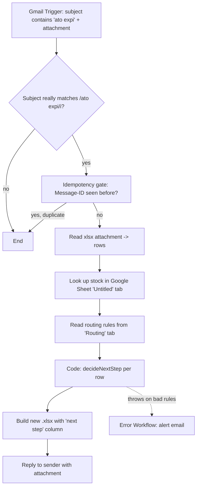

# ato-expiry-automation — design spec

Date: 2026-10-12
Status: approved

## Problem

Portfolio piece (not connected to any real company system, all data fake):
an email arrives reporting ATO (About To Obsolete / expiry) finished-good
stock. The workflow reads the attached spreadsheet, looks up how much raw
material exists upstream for each finished-good SKU, decides the next
manufacturing step for each row, and emails the result back as a new
spreadsheet.

## Scope

In scope: one n8n workflow (`ato-expiry-automation`), one error-handling
workflow, the routing decision as a pure, independently-tested function,
sample input/output fixtures, and a README.

Out of scope (explicitly not building unless asked): real SQL/DB
integration, real auth, a UI, multi-tenant/multi-mailbox support, retry
scheduling beyond n8n's own error-workflow mechanism.

## Flow

1. **Gmail Trigger** — polls for mail matching
   `subject:"ato expi" has:attachment`, downloading attachments.
   Credential: `gmailOAuth2` (reference only, no inline secret).
2. **Subject really matches?** (`if`) — defensive re-check with
   `/ato expi/i` against the actual subject, since Gmail's search query is
   fuzzy/stemmed and not a true regex. Non-matches end the run quietly.
3. **Idempotency gate** (`removeDuplicates` v2, "remove items seen in
   previous executions") — keyed on the email's RFC `Message-ID` header.
   Uses n8n's own dedupe store; no external DB needed. Satisfies "the same
   email is never processed twice."
4. **Read xlsx attachment** (`extractFromFile`) — binary → JSON rows of
   `sku, description, qty`.
5. **Look up stock** (`googleSheets`, get rows) — reads tab `Untitled` of
   spreadsheet `{{$env.STOCK_SHEET_ID}}`. Carries a sticky note: *"Replace
   this node with an SQL query node against the real stock database."*
6. **Read routing rules** (`googleSheets`, get rows) — reads tab `Routing`
   of the same spreadsheet: columns `stock prefix`, `stage`, `next step`,
   `check order`.
7. **Decide next step** (`code`, run-once-for-all-items) — the one
   required Code node. Wraps a pure function `decideNextStep(row,
   stockIndex, rules)` (see below). Throws (does not guess) if the rules
   input is missing/malformed.
8. **Build xlsx** (`convertToFile`) — JSON rows (now including `next
   step`) → a new `.xlsx` binary.
9. **Reply** (`gmail`, reply to message) — threaded reply to the original
   sender with the new file attached.



## Routing logic (pure function)

Product identity = the 8 digits after the 3-digit prefix. For SKU
`30026196225`: prefix `300`, body `26196225`. The matching `310` and `400`
rows in the database share that same 8-digit body.

```
decideNextStep(row, stockIndex, rules):
  record = stockIndex.get(row.sku)      // keyed on column G (300... code)
  if record is undefined:
      return "SKU NOT FOUND"

  body = record.sku.slice(3)            // 8 digits after the 300 prefix
  stockByPrefix = {
      "300": record.finishedQty,
      "310": lookup 310-body in stockIndex's parent table,
      "400": lookup 400-body in stockIndex's parent table,
  }

  for rule in rules sorted by rule.checkOrder ascending:
      qty = stockByPrefix[rule.prefix] ?? 0
      if qty > 0:
          return rule.nextStep

  return rules.find(r => r.prefix === "none").nextStep
```

Nothing about `300`/`310`/`400` → step-name mapping is hardcoded beyond the
*order in which prefixes are tried*, which itself comes from the `Routing`
tab's `check order` column. The `"none"` fallback row is also read from the
sheet rather than literally hardcoded as a string — only the *shape* of a
row (prefix/stage/next step/order) is assumed.

**Default routing table** (seeded onto the `Routing` tab; editable there):

| stock prefix | stage | next step | check order |
|---|---|---|---|
| 300 | Finished good | Finished, no action | 1 |
| 310 | Drilled blank | Drill | 2 |
| 400 | Raw panel | Edge and drill | 3 |
| none | — | Cut, edge and drill | 4 |

## Error handling

Two distinct failure classes, handled differently on purpose:

- **Row-level, expected**: SKU not in the database → that row's `next
  step` = `"SKU NOT FOUND"`, loop continues. This is normal output, not an
  error.
- **Step-level, unexpected**: the Routing-rules read fails, comes back
  empty, or is missing a required column → the Code node throws. No
  `continueOnFail` is set anywhere between the two Google Sheets reads and
  the Code node, so a failure here fails the whole execution rather than
  silently inventing a next step.

A second workflow, `ato-expiry-error-handler`, is set as this workflow's
**Error Workflow** (Settings → Error Workflow). It receives the failed
execution via an Error Trigger node and sends an alert email to
`{{$env.ALERT_EMAIL_TO}}` via the same Gmail credential.

## Testing

`tests/routing.test.js` (Node's built-in `node:test` + `assert`, zero
dependencies) does **not** reimplement the function. It reads
`workflows/ato-expiry-automation.json`, extracts the `jsCode` string from
the "Decide next step" node, and `eval`s it in a small sandbox to obtain
`decideNextStep`, so the tests exercise exactly what ships in the
workflow — they cannot silently drift from it.

Cases:
1. SKU found, 300 stock > 0 → "Finished, no action"
2. SKU found, 300 = 0, 310 > 0 → "Drill"
3. SKU found, 300 = 0, 310 = 0, 400 > 0 → "Edge and drill"
4. SKU found, all zero → "Cut, edge and drill"
5. SKU not in database → "SKU NOT FOUND"
6. Malformed/empty rules input → throws (does not guess)

## Sample data

`sample/input.xlsx`: 10 invented, fully-fake tiled-panel finished-good
rows (`sku, description, qty`), 300-prefixed 11-digit codes, covering a mix
of all four stock outcomes plus one SKU absent from the sample database so
"SKU NOT FOUND" is exercised. The user will compose and send the real
trigger email themselves when testing live; this file is a static fixture
for the README/tests, not a canned n8n "pinned data" shortcut.

`sample/expected-output.xlsx`: the same rows with the `next step` column
filled in by hand-running the routing table above, for manual diffing
against what the workflow produces.

## Export hygiene

- No credential IDs, API keys, or webhook URLs committed. Google Sheets
  and Gmail nodes reference credentials by type only
  (`googleSheetsOAuth2Api`, `gmailOAuth2`); the exported JSON holds no
  credential `id`/`name` pair beyond what n8n itself writes as a
  placeholder on export.
- `STOCK_SHEET_ID` and `ALERT_EMAIL_TO` are read via `{{$env....}}`
  expressions, never literals, and are listed in `.env.example`.
- No `pinData` block in the exported workflow JSON.
- `.gitignore` excludes `.env`, `node_modules/`, OS/editor cruft.

## Env vars

| Var | Used by | Purpose |
|---|---|---|
| `STOCK_SHEET_ID` | main workflow | Google Sheet ID for the stock "database" |
| `ALERT_EMAIL_TO` | error-handler workflow | recipient of failure alert emails |

Note: reading `$env` inside node expressions requires the n8n instance be
started with `N8N_BLOCK_ENV_ACCESS_IN_NODE=false`. Documented in the
README setup section.

## Deliverables

- `workflows/ato-expiry-automation.json`
- `workflows/ato-expiry-error-handler.json` (the required Error Workflow —
  a second file, since n8n error workflows must be separate workflows)
- `tests/routing.test.js`, `package.json` (`npm test` → `node --test`)
- `sample/input.xlsx`, `sample/expected-output.xlsx`
- `README.md` (problem, mermaid flow diagram, setup, routing table,
  assumptions, "what I'd change for real systems")
- `.gitignore`, `.env.example`
